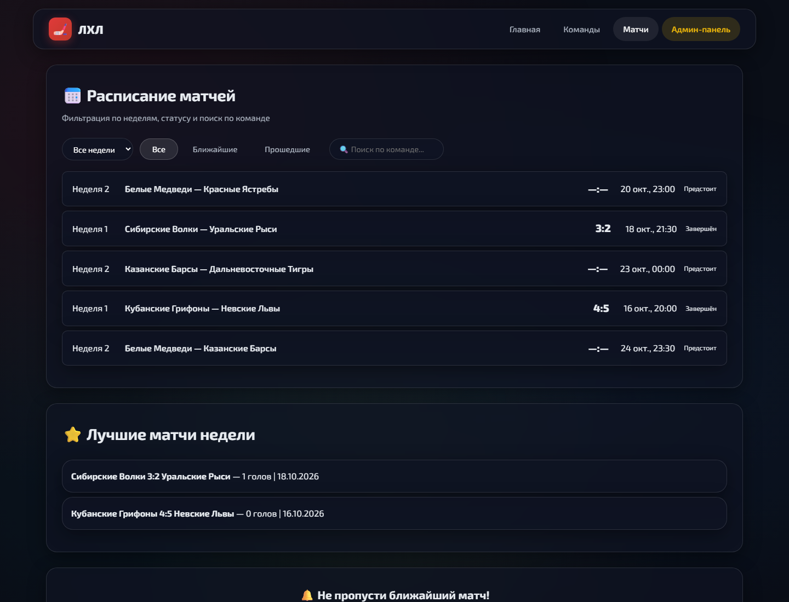
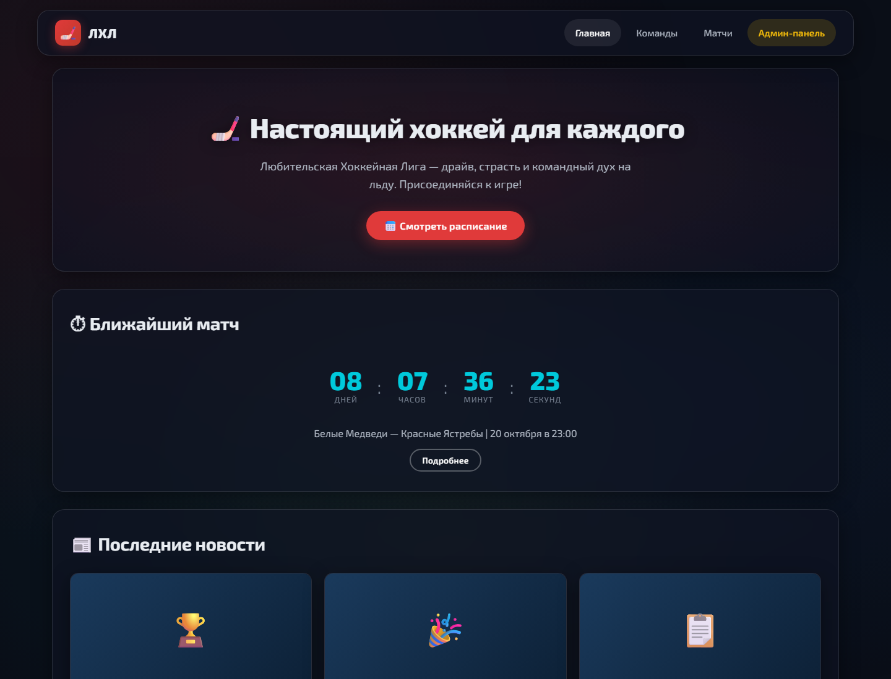
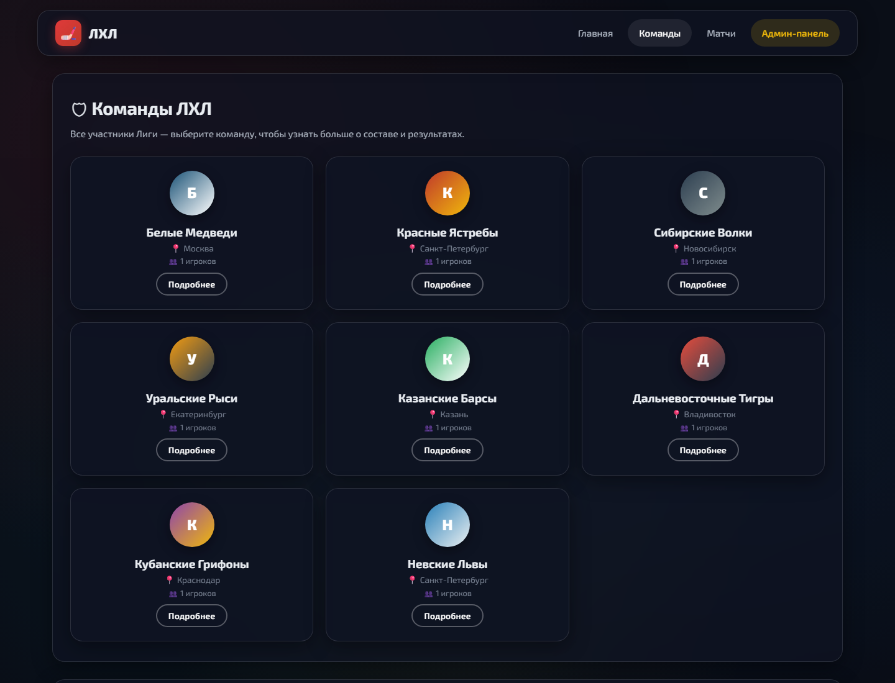

# LHL Hockey

An amateur hockey league website and REST API built with NestJS, TypeScript, PostgreSQL, and a responsive HTML/CSS/JavaScript frontend. League standings, team rosters, fixtures, results, and news are stored in PostgreSQL and loaded by the browser through the API.

## Screenshots

Screenshots show the website with sample league records.

| Homepage                                                       | Teams                                                   |
| -------------------------------------------------------------- | ------------------------------------------------------- |
|  |  |

### Match schedule



## Features

- League homepage with standings, news, team directory, and match countdown.
- Team profiles with roster, statistics, and match history.
- Match schedule with status, week, and team filters.
- PostgreSQL persistence for teams, players, matches, and news, initialized by a TypeORM migration.
- Public REST endpoints: `GET /teams`, `GET /matches`, and `GET /news`.
- JWT-protected staff login and role-guarded `GET /admin/dashboard`.
- Request validation with `class-validator` and `ValidationPipe`.
- Swagger UI at `/api/docs`.
- NestJS unit tests, ESLint, Prettier, and TypeScript.

## Local development

Requirements: Node.js 20 or newer and PostgreSQL.

1. Install dependencies:

   ```bash
   npm ci
   ```

2. Create a PostgreSQL database, copy `.env.example` to `.env`, and set `DATABASE_URL`.
3. Generate a bcrypt password hash for the admin account:

   ```bash
   node -e "console.log(require('bcryptjs').hashSync('replace-this-password', 12))"
   ```

   Set the output as `ADMIN_PASSWORD_HASH`, choose `ADMIN_EMAIL`, and replace `JWT_SECRET` with a random secret of at least 32 characters. Never commit `.env`.

4. Start the application:

   ```bash
   npm run start:dev
   ```

   TypeORM runs the initial schema and sample-data migration at startup. Open `http://localhost:3000`; API documentation is at `http://localhost:3000/api/docs`.

## API

| Method | Endpoint           | Access                  | Description                                  |
| ------ | ------------------ | ----------------------- | -------------------------------------------- |
| `GET`  | `/teams`           | Public                  | Teams and player rosters                     |
| `GET`  | `/matches`         | Public                  | Fixtures and results                         |
| `GET`  | `/news`            | Public                  | League news                                  |
| `POST` | `/auth/login`      | Public                  | Exchange admin credentials for an 8-hour JWT |
| `GET`  | `/admin/dashboard` | `admin` or `editor` JWT | Verify staff identity and role               |

## Tests and quality checks

```bash
npm test
npm run test:e2e
npm run lint
npm run format
npm run build
```

## Deployment

The repository includes a Render Blueprint in `render.yaml`. Create a Render PostgreSQL database, connect its internal connection string as `DATABASE_URL`, and set `ADMIN_EMAIL` and a bcrypt `ADMIN_PASSWORD_HASH` in the service environment. Render generates `JWT_SECRET`; the service runs `npm run build` and `npm run start:prod`. The initial database migration runs on service startup.

Set `DATABASE_SSL=true` only when the selected PostgreSQL provider requires TLS. Add the deployed URL to the repository About section after deployment.

## Repository topics

`nestjs` · `typescript` · `hockey`
